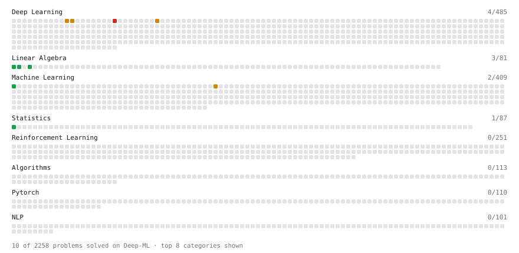

# Deep-ML

My machine learning practice from [Deep-ML](https://www.deep-ml.com). Every solution here was written by hand.

**58** solved · 58 problems · 0 labs · 0 math

[**Browse the interactive portfolio**](https://renatovukovic.github.io/deep-ml/) to replay this filling in over time.

## Problems

| | Difficulty | Solved | |
| --- | --- | --- | --- |
| [Adagrad Optimizer](https://www.deep-ml.com/problems/145) | easy | 2026-09-16 | [solution](problems/0145-adagrad-optimizer) |
| [Calculate 2x2 Matrix Inverse](https://www.deep-ml.com/problems/8) | easy | 2026-07-29 | [solution](problems/0008-calculate-2x2-matrix-inverse) |
| [Calculate Computational Efficiency of MoE](https://www.deep-ml.com/problems/123) | easy | 2026-09-10 | [solution](problems/0123-calculate-computational-efficiency-of-moe) |
| [Calculate Cosine Similarity Between Vectors](https://www.deep-ml.com/problems/76) | easy | 2026-08-19 | [solution](problems/0076-calculate-cosine-similarity-between-vectors) |
| [Calculate Covariance Matrix](https://www.deep-ml.com/problems/10) | easy | 2026-04-30 | [solution](problems/0010-calculate-covariance-matrix) |
| [Calculate F1 Score from Predicted and True Labels](https://www.deep-ml.com/problems/91) | easy | 2026-08-30 | [solution](problems/0091-calculate-f1-score-from-predicted-and-true-labels) |
| [Calculate Mean Absolute Error (MAE)](https://www.deep-ml.com/problems/93) | easy | 2026-08-29 | [solution](problems/0093-calculate-mean-absolute-error-mae) |
| [Calculate Mean by Row or Column](https://www.deep-ml.com/problems/4) | easy | 2026-04-22 | [solution](problems/0004-calculate-mean-by-row-or-column) |
| [Calculate R-squared for Regression Analysis](https://www.deep-ml.com/problems/69) | easy | 2026-08-17 | [solution](problems/0069-calculate-r-squared-for-regression-analysis) |
| [Calculate Root Mean Square Error (RMSE)](https://www.deep-ml.com/problems/71) | easy | 2026-08-18 | [solution](problems/0071-calculate-root-mean-square-error-rmse) |
| [Compute Multi-class Cross-Entropy Loss](https://www.deep-ml.com/problems/134) | easy | 2026-09-07 | [solution](problems/0134-compute-multi-class-cross-entropy-loss) |
| [Compute TPR and FPR from Classifications](https://www.deep-ml.com/problems/1217) | easy | 2026-07-28 | [solution](problems/1217-compute-tpr-and-fpr-from-classifications) |
| [Derivative of a Polynomial](https://www.deep-ml.com/problems/116) | easy | 2026-09-01 | [solution](problems/0116-derivative-of-a-polynomial) |
| [Detect Overfitting or Underfitting](https://www.deep-ml.com/problems/86) | easy | 2026-08-26 | [solution](problems/0086-detect-overfitting-or-underfitting) |
| [Exponential Weighted Average of Rewards](https://www.deep-ml.com/problems/161) | easy | 2026-10-02 | [solution](problems/0161-exponential-weighted-average-of-rewards) |
| [Implement a Simple Residual Block with Shortcut Connection](https://www.deep-ml.com/problems/113) | easy | 2026-09-04 | [solution](problems/0113-implement-a-simple-residual-block-with-shortcut-connection) |
| [Implement Early Stopping Based on Validation Loss](https://www.deep-ml.com/problems/135) | easy | 2026-09-14 | [solution](problems/0135-implement-early-stopping-based-on-validation-loss) |
| [Implement Gini Impurity Calculation for a Set of Classes](https://www.deep-ml.com/problems/64) | easy | 2026-08-17 | [solution](problems/0064-implement-gini-impurity-calculation-for-a-set-of-classes) |
| [Implement SwiGLU activation function](https://www.deep-ml.com/problems/156) | easy | 2026-09-25 | [solution](problems/0156-implement-swiglu-activation-function) |
| [Implement the Swish Activation Function](https://www.deep-ml.com/problems/102) | easy | 2026-08-30 | [solution](problems/0102-implement-the-swish-activation-function) |
| [Incremental Mean for Online Reward Estimation](https://www.deep-ml.com/problems/159) | easy | 2026-10-05 | [solution](problems/0159-incremental-mean-for-online-reward-estimation) |
| [KL Divergence Between Two Normal Distributions](https://www.deep-ml.com/problems/56) | easy | 2026-08-14 | [solution](problems/0056-kl-divergence-between-two-normal-distributions) |
| [Linear Regression Using Gradient Descent](https://www.deep-ml.com/problems/15) | easy | 2026-07-24 | [solution](problems/0015-linear-regression-using-gradient-descent) |
| [Linear Regression Using Normal Equation](https://www.deep-ml.com/problems/14) | easy | 2026-03-30 | [solution](problems/0014-linear-regression-using-normal-equation) |
| [Matrix-Vector Dot Product](https://www.deep-ml.com/problems/1) | easy | 2026-03-31 | [solution](problems/0001-matrix-vector-dot-product) |
| [Momentum Optimizer](https://www.deep-ml.com/problems/146) | easy | 2026-09-17 | [solution](problems/0146-momentum-optimizer) |
| [Nesterov Accelerated Gradient Optimizer](https://www.deep-ml.com/problems/150) | easy | 2026-09-21 | [solution](problems/0150-nesterov-accelerated-gradient-optimizer) |
| [Sigmoid Activation Function Understanding](https://www.deep-ml.com/problems/22) | easy | 2026-08-13 | [solution](problems/0022-sigmoid-activation-function-understanding) |
| [Single Neuron](https://www.deep-ml.com/problems/24) | easy | 2026-07-30 | [solution](problems/0024-single-neuron) |
| [Softmax Activation Function Implementation ](https://www.deep-ml.com/problems/23) | easy | 2026-07-27 | [solution](problems/0023-softmax-activation-function-implementation) |
| [Transpose of a Matrix](https://www.deep-ml.com/problems/2) | easy | 2026-03-31 | [solution](problems/0002-transpose-of-a-matrix) |
| [Upper Confidence Bound (UCB) Action Selection](https://www.deep-ml.com/problems/162) | easy | 2026-10-02 | [solution](problems/0162-upper-confidence-bound-ucb-action-selection) |
| [Adadelta Optimizer](https://www.deep-ml.com/problems/149) | medium | 2026-09-22 | [solution](problems/0149-adadelta-optimizer) |
| [Adam Optimizer](https://www.deep-ml.com/problems/87) | medium | 2026-08-22 | [solution](problems/0087-adam-optimizer) |
| [Calculate Eigenvalues of a Matrix](https://www.deep-ml.com/problems/6) | medium | 2026-07-24 | [solution](problems/0006-calculate-eigenvalues-of-a-matrix) |
| [Calculate KL Divergence Between Two Multivariate Gaussian Distributions](https://www.deep-ml.com/problems/136) | medium | 2026-09-24 | [solution](problems/0136-calculate-kl-divergence-between-two-multivariate-gaussian-distributions) |
| [Calculate Performance Metrics for a Classification Model](https://www.deep-ml.com/problems/77) | medium | 2026-08-27 | [solution](problems/0077-calculate-performance-metrics-for-a-classification-model) |
| [Dropout Layer](https://www.deep-ml.com/problems/151) | medium | 2026-09-23 | [solution](problems/0151-dropout-layer) |
| [Epsilon-Greedy Action Selection for n-Armed Bandit](https://www.deep-ml.com/problems/158) | medium | 2026-10-01 | [solution](problems/0158-epsilon-greedy-action-selection-for-n-armed-bandit) |
| [Find the Best Gini-Based Split for a Binary Decision Tree](https://www.deep-ml.com/problems/138) | medium | 2026-09-15 | [solution](problems/0138-find-the-best-gini-based-split-for-a-binary-decision-tree) |
| [Implement Adam Optimization Algorithm](https://www.deep-ml.com/problems/49) | medium | 2026-05-27 | [solution](problems/0049-implement-adam-optimization-algorithm) |
| [Implement AdamW Optimizer Step](https://www.deep-ml.com/problems/169) | medium | 2026-10-06 | [solution](problems/0169-implement-adamw-optimizer-step) |
| [Implement Batch Normalization for BCHW Input](https://www.deep-ml.com/problems/115) | medium | 2026-09-03 | [solution](problems/0115-implement-batch-normalization-for-bchw-input) |
| [Implement Layer Normalization for Sequence Data](https://www.deep-ml.com/problems/109) | medium | 2026-05-01 | [solution](problems/0109-implement-layer-normalization-for-sequence-data) |
| [Implement Masked Self-Attention](https://www.deep-ml.com/problems/107) | medium | 2026-04-30 | [solution](problems/0107-implement-masked-self-attention) |
| [Implement Q-Learning Algorithm for MDPs](https://www.deep-ml.com/problems/133) | medium | 2026-09-11 | [solution](problems/0133-implement-q-learning-algorithm-for-mdps) |
| [Implement Self-Attention Mechanism](https://www.deep-ml.com/problems/53) | medium | 2026-04-23 | [solution](problems/0053-implement-self-attention-mechanism) |
| [Implement the Bellman Equation for Value Iteration](https://www.deep-ml.com/problems/157) | medium | 2026-09-30 | [solution](problems/0157-implement-the-bellman-equation-for-value-iteration) |
| [Implementing a Simple RNN](https://www.deep-ml.com/problems/54) | medium | 2026-08-15 | [solution](problems/0054-implementing-a-simple-rnn) |
| [K-Means Clustering](https://www.deep-ml.com/problems/17) | medium | 2026-07-28 | [solution](problems/0017-k-means-clustering) |
| [Normal Distribution PDF Calculator](https://www.deep-ml.com/problems/80) | medium | 2026-08-21 | [solution](problems/0080-normal-distribution-pdf-calculator) |
| [Simulate Markov Chain Transitions](https://www.deep-ml.com/problems/132) | medium | 2026-09-09 | [solution](problems/0132-simulate-markov-chain-transitions) |
| [Single Neuron with Backpropagation](https://www.deep-ml.com/problems/25) | medium | 2026-07-30 | [solution](problems/0025-single-neuron-with-backpropagation) |
| [Flash Attention v1 - Forward Pass](https://www.deep-ml.com/problems/208) | hard | 2026-06-11 | [solution](problems/0208-flash-attention-v1-forward-pass) |
| [Implement Multi-Head Attention](https://www.deep-ml.com/problems/94) | hard | 2026-04-24 | [solution](problems/0094-implement-multi-head-attention) |
| [Implement the GRPO Objective Function](https://www.deep-ml.com/problems/101) | hard | 2026-08-28 | [solution](problems/0101-implement-the-grpo-objective-function) |
| [Positional Encoding Calculator](https://www.deep-ml.com/problems/85) | hard | 2026-08-23 | [solution](problems/0085-positional-encoding-calculator) |
| [Train Softmax Regression with Gradient Descent](https://www.deep-ml.com/problems/105) | hard | 2026-08-31 | [solution](problems/0105-train-softmax-regression-with-gradient-descent) |

---

_This file is regenerated by Deep-ML on every push._
